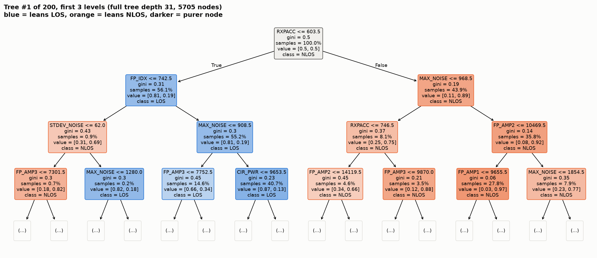
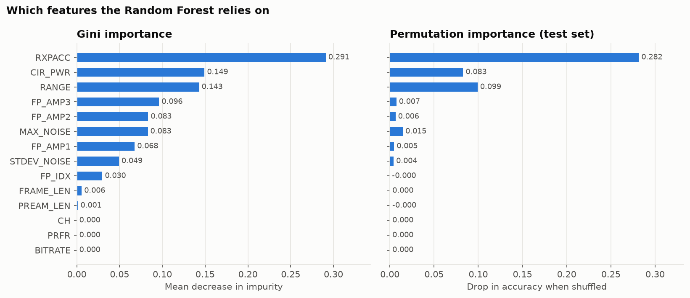
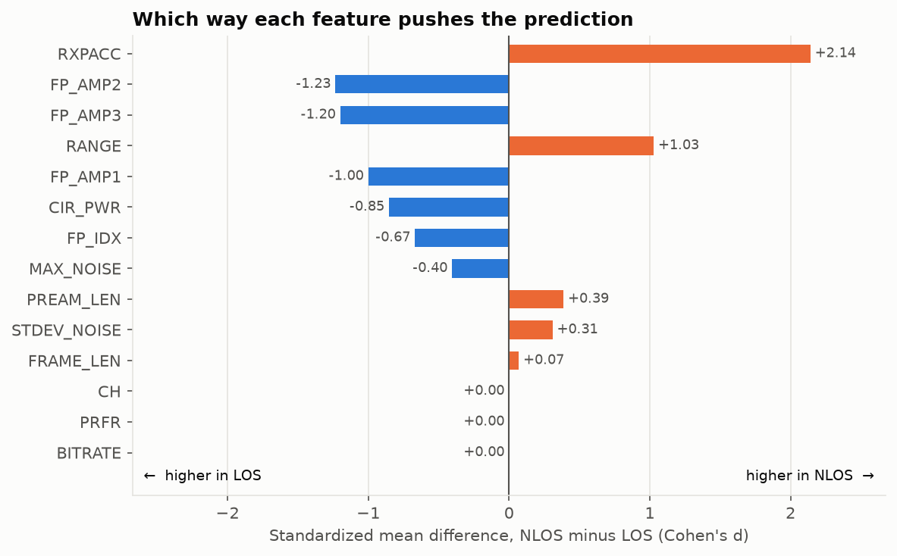
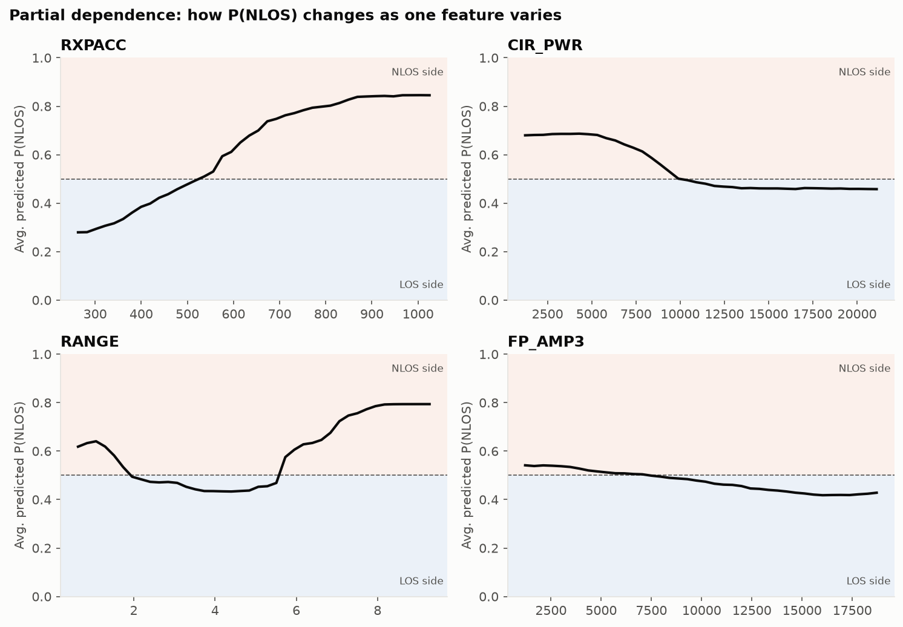

# NLOS vs LOS Classification: Random Forest Results

This is a simple Random Forest that predicts whether a UWB range measurement was taken under
**line-of-sight (LOS)** or **non-line-of-sight (NLOS)** conditions. It uses the per-measurement
diagnostics the radio reports.

- Training / evaluation script: [`random_forest_nlos.py`](random_forest_nlos.py)
- Figure + metrics generator: [`make_results.py`](make_results.py), which writes to [`figures/`](figures/)

## TL;DR

| Metric | Value |
|---|---|
| Test accuracy (20% hold-out) | **90.9%** |
| Test ROC AUC | **0.969** |
| 5-fold cross-validated accuracy | **91.2% ± 0.4%** |
| Most important feature | **`RXPACC`** (preamble accumulation count) |

Signs that point to **NLOS**: high `RXPACC`, longer `RANGE`, and weak first-path amplitudes / low `CIR_PWR`.
Signs that point to **LOS**: low `RXPACC`, a strong first path, and high received CIR power.

---

## 1. Data

All 7 files in `data/uwb_dataset_part*.csv` are concatenated.

| | Count |
|---|---|
| Total measurements | 42,000 |
| LOS (`NLOS = 0`) | 21,000 |
| NLOS (`NLOS = 1`) | 21,000 |
| Train / test split | 33,600 / 8,400 (stratified 80/20, `random_state=42`) |

Each row has a label (`NLOS`), 14 scalar diagnostics, and 1,016 raw channel impulse response
samples (`CIR0` … `CIR1015`).

## 2. Architecture

```
 data/uwb_dataset_part1..7.csv
             │  pandas.concat
             ▼
 42,000 rows × 1,031 columns
             │  select features (drop label + raw CIR0..CIR1015)
             ▼
 14 scalar features ──► stratified 80/20 split
                              │
                              ▼
          ┌───────────────────────────────────────────┐
          │  RandomForestClassifier (scikit-learn)    │
          │                                           │
          │   bootstrap sample ─► Tree 1 ─┐           │
          │   bootstrap sample ─► Tree 2 ─┤           │
          │          ...                  ├─► average │
          │   bootstrap sample ─► Tree 200┘   P(NLOS) │
          │                                           │
          └───────────────────────────────────────────┘
                              │  P(NLOS) > 0.5 ?
                              ▼
                        LOS  /  NLOS
```

### Features (14)

| Feature | Meaning |
|---|---|
| `RANGE` | Measured distance (m) |
| `FP_IDX` | Index of the detected first path in the CIR |
| `FP_AMP1`, `FP_AMP2`, `FP_AMP3` | Amplitudes of the first-path harmonics |
| `STDEV_NOISE` | Standard deviation of the noise floor |
| `CIR_PWR` | Total received channel impulse response power |
| `MAX_NOISE` | Maximum noise value |
| `RXPACC` | Received preamble symbols accumulated |
| `CH`, `BITRATE`, `PRFR` | Channel / bit rate / pulse repetition frequency. **Constant across the dataset, so they contribute nothing.** |
| `FRAME_LEN`, `PREAM_LEN` | Frame length / preamble length |

The raw CIR samples are left out by default. Run `python NLOS/random_forest_nlos.py --use-cir` to include them.

### Hyperparameters

| Parameter | Value |
|---|---|
| `n_estimators` | 200 trees |
| `criterion` | Gini impurity |
| `max_depth` | None (trees grow until leaves are pure) |
| `max_features` | `sqrt` (≈ 3 of 14 features considered at each split) |
| `bootstrap` | True |
| `random_state` | 42 |

These are scikit-learn defaults apart from `n_estimators`. No tuning has been done yet.

### Trained forest size

| | Min | Mean | Max |
|---|---|---|---|
| Tree depth | 25 | 30.4 | 42 |
| Nodes per tree | | 5,694 | |
| Leaves per tree | | 2,847 | |

## 3. What the Random Forest looks like

The forest is 200 independent decision trees. Each one is trained on a bootstrap resample of the
training set, and each split only considers a random subset of features. The final prediction is
the average of the trees' NLOS probabilities.

Below are the top 3 levels of **one** of those trees. The full tree is 31 levels deep with 5,705 nodes.
`value = [P(LOS), P(NLOS)]` is the class mix of the training samples that reach that node.



How to read it:
- **Root split: `RXPACC <= 603.5`.** This single question already separates the data well:
  - `RXPACC ≤ 603.5` → 81% LOS (56% of samples)
  - `RXPACC > 603.5` → 89% NLOS (44% of samples)
- Lower levels refine this with the noise level (`MAX_NOISE`), the first-path amplitudes (`FP_AMP1/2/3`) and `CIR_PWR`.
- The purest early node is `RXPACC > 603.5` **and** `MAX_NOISE > 968.5` **and** `FP_AMP2 ≤ 10469.5` **and** `FP_AMP1 ≤ 9655.5`, which is **97% NLOS**. In plain terms: many accumulated preamble symbols plus a weak first path is almost always NLOS.

## 4. Most important features



| Rank | Feature | Gini importance | Permutation importance (accuracy drop) |
|---|---|---|---|
| 1 | `RXPACC` | 0.291 | 0.282 |
| 2 | `CIR_PWR` | 0.149 | 0.083 |
| 3 | `RANGE` | 0.143 | 0.099 |
| 4 | `FP_AMP3` | 0.096 | 0.007 |
| 5 | `FP_AMP2` | 0.083 | 0.006 |
| 6 | `MAX_NOISE` | 0.083 | 0.015 |
| 7 | `FP_AMP1` | 0.068 | 0.005 |
| 8 | `STDEV_NOISE` | 0.049 | 0.004 |
| 9 | `FP_IDX` | 0.030 | ≈ 0 |
| — | `FRAME_LEN`, `PREAM_LEN`, `CH`, `BITRATE`, `PRFR` | ≤ 0.006 | ≈ 0 |

- **Gini importance** measures how much each feature reduces impurity across all splits, as computed during training.
- **Permutation importance** measures how much test accuracy drops when that one feature's values are randomly shuffled.

The two measures agree that `RXPACC`, `RANGE` and `CIR_PWR` carry most of the signal. Shuffling
`RXPACC` alone costs 28 points of accuracy. The three `FP_AMP` features score well on Gini but low
on permutation. That's because they are strongly correlated with each other and with `CIR_PWR`:
when one is shuffled, the others make up for it.

## 5. Which features push toward NLOS vs LOS

Importance says *how much* a feature matters, but not *which class* it points to. The chart below
gives the direction. It shows the standardized difference in each feature's mean between NLOS and
LOS samples (Cohen's d). Orange bars mean the feature is higher in NLOS; blue bars mean it is higher in LOS.



| Feature | Median (LOS) | Median (NLOS) | Points toward |
|---|---|---|---|
| `RXPACC` | 332 | **1024** | High → **NLOS** |
| `RANGE` (m) | 2.43 | **4.89** | Long → **NLOS** |
| `FP_AMP1` | **10,472** | 4,554 | Strong first path → **LOS** |
| `FP_AMP2` | **16,769** | 6,377 | Strong first path → **LOS** |
| `FP_AMP3` | **12,984** | 5,474 | Strong first path → **LOS** |
| `CIR_PWR` | **11,154** | 7,338 | High power → **LOS** |
| `MAX_NOISE` | **1,277** | 1,087 | Slightly higher → LOS |
| `STDEV_NOISE` | 64 | **72** | Slightly higher → NLOS |

### Partial dependence (how the model itself responds)

Each panel shows the model's average predicted P(NLOS) as one feature is swept over its range
while the others are left as they are.



- **`RXPACC`**: P(NLOS) rises steadily from about 0.28 to about 0.85, crossing 0.5 near **~530**. The receiver needs to accumulate more preamble symbols when the direct path is blocked and the signal is weaker.
- **`CIR_PWR`**: below roughly 10,000 the model leans NLOS (≈ 0.68); above it, the model leans LOS. An obstruction reduces the received power.
- **`RANGE`**: the relationship is not monotonic. Mid ranges (about 2–5.5 m) lean LOS; beyond about 6 m, P(NLOS) climbs to around 0.8. The model has partly learned the geometry of the measurement environment, which may not carry over to other sites (see Limitations).
- **`FP_AMP3`**: weak first-path amplitude leans NLOS, but the effect on its own is mild because `FP_AMP1/2` and `CIR_PWR` carry overlapping information.

## 6. Results

Evaluated on the 8,400-sample held-out test set.

| Class | Precision | Recall | F1 | Support |
|---|---|---|---|---|
| LOS | 0.894 | 0.927 | 0.910 | 4,200 |
| NLOS | 0.924 | 0.890 | 0.907 | 4,200 |
| **Overall accuracy** | | | **0.909** | 8,400 |

**ROC AUC:** 0.969  **5-fold CV accuracy:** 0.912 ± 0.004

### Confusion matrix

| | Predicted LOS | Predicted NLOS |
|---|---|---|
| **True LOS** | 3,894 | 306 |
| **True NLOS** | 462 | 3,738 |

The model misses NLOS more often (462 false LOS) than it raises false alarms (306 false NLOS).
For localization, a missed NLOS is the more costly error: a biased range gets trusted. If that
matters, lowering the decision threshold below 0.5 would trade some LOS precision for higher NLOS recall.

## 7. Limitations and next steps

- **Random split, not split by location.** The train and test sets come from the same environments, so 91% is probably optimistic for a new building. A split by location or by file would be a more honest test.
- **`RANGE` as a feature** partly encodes the layout of the measurement environment rather than the physics of an obstruction.
- **Raw CIR not used.** The 1,016 CIR samples carry rich multipath information. Hand-built features (kurtosis, rise time, mean excess delay, RMS delay spread) or `--use-cir` should push accuracy higher.
- **No hyperparameter tuning** yet (`max_depth`, `min_samples_leaf`, `max_features`).
- **Dead features:** `CH`, `BITRATE` and `PRFR` are constant and can be dropped.

## Reproduce

```bash
pip install pandas scikit-learn matplotlib
python NLOS/random_forest_nlos.py   # train + print metrics
python NLOS/make_results.py         # regenerate figures/ and figures/metrics.json
```
